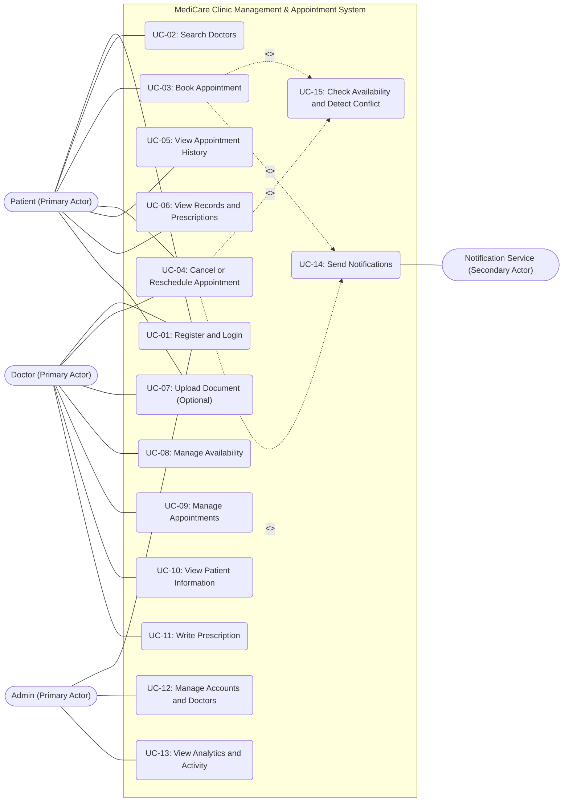

# 4.1 Problem Statement, Use Cases & Software Architecture

**Project Name:** MediCare - Clinic Management & Appointment System  
**DEPI Track:** Full Stack .NET Web Developer  
**Submission Deadline:** 6 November 2026  

[$\leftarrow$ Back to Main README](../README.md)

---

## 1. Problem Statement & Objectives

### Problem Statement
Appointment management in many clinics relies on manual or fragmented systems, leading to persistent operational challenges:
* **Double Booking:** Conflicting appointments occur because different parties rely on uncoordinated schedules.
* **Patient Access Barriers:** Patients face difficulty finding the right doctor based on specialty, location, and available time slots.
* **Disorganized Medical Records:** Medical history and prescriptions lack centralized organization and proper access control.
* **Lack of Automated Reminders:** Absence of automated appointment confirmations and status updates leads to high no-show rates.
* **Limited Operational Insights:** Clinic administration lacks key performance metrics to evaluate efficiency and workload.

### Project Objectives
| ID | Objective Description |
| :--- | :--- |
| **O1** | Enable patients to search for doctors filtered by specialty, location, and available time slots. |
| **O2** | Minimize schedule conflicts using server-side validation and atomic database transactions. |
| **O3** | Empower doctors to manage working hours, review appointment lists, and inspect patient history. |
| **O4** | Provide patients secure, read-only access to their authorized appointment logs and prescriptions. |
| **O5** | Deliver automated notifications for confirmations, reschedules, and cancellations. |
| **O6** | Equip administrators with tools for account management, doctor onboarding, and activity tracking. |
| **O7** | Improve overall clinic workflow coordination and provide metric insights into operational performance. |

### Project Scope Boundary
| In-Scope (Supported Features) | Out-of-Scope (Excluded Features) |
| :--- | :--- |
| • Authentication & Role-Based Access Control (`Patient`, `Doctor`, `Admin`) • Doctor Profiles & Multi-Criteria Search (Specialty, Location, Availability) • Weekly Slot Availability & Schedule Management • Appointment Booking, Cancellation & Rescheduling • Server-Side Conflict Detection & Double-Booking Prevention • Patient & Doctor Dashboards • Authorized Medical Record & Prescription Viewing • Medical Document Upload • System Notifications (SignalR / Email / SMS / Mock Provider) • Admin Account Management, Activity Logs & Analytics Dashboard | • Clinical Medical Diagnosis & Clinical Decision Support Systems • Emergency Care Management & Triage Handling • Integrated Financial Payments, Invoicing & Insurance Processing • Direct API Integration with External Hospital Information Systems (HIS) • Storage or Processing of Real Patient Identifiable Data (Mock Data Only) |

---

## 1.1 Use Case Diagram & Descriptions

### Visual Use Case Diagram

### Use Case Summary Matrix
| UC ID | Use Case Name | Primary / Secondary Actor(s) |
| :--- | :--- | :--- |
| **UC-01** | Register and Login | Patient, Doctor, Admin |
| **UC-02** | Search Doctors | Patient |
| **UC-03** | Book Appointment | Patient |
| **UC-04** | Cancel or Reschedule Appointment | Patient, Doctor |
| **UC-05** | View Appointment History | Patient |
| **UC-06** | View Records and Prescriptions | Patient |
| **UC-07** | Upload Document (Optional) | Patient, Doctor |
| **UC-08** | Manage Availability | Doctor |
| **UC-09** | Manage Appointments | Doctor |
| **UC-10** | View Patient Information | Doctor |
| **UC-11** | Write Prescription | Doctor |
| **UC-12** | Manage Accounts and Doctors | Admin |
| **UC-13** | View Analytics and Activity | Admin |
| **UC-14** | Send Notifications | Notification Service |
| **UC-15** | Check Availability and Detect Conflict | System (Included) |

### Detailed Core Use Case Specifications

#### UC-03: Book Appointment
* **Actor:** Patient
* **Precondition:** Patient is authenticated and doctor has published available slots.
* **Main Flow:**
  1. Patient searches for a doctor (`UC-02`).
  2. Patient selects doctor, date, and desired time slot.
  3. Patient provides reason for visit and submits booking request.
  4. System validates inputs and user authorization.
  5. System performs re-check of slot availability inside a DB transaction (`UC-15`).
  6. Appointment record is saved with status `Pending`.
  7. System triggers notification to Patient and Doctor (`UC-14`).
* **Alternate Flows:**
  * *A. Slot already taken:* System rejects booking, shows conflict message, and prompts user to choose another slot.
  * *B. Invalid input or past date:* System presents inline error message.
* **Postcondition:** Appointment is created in DB; slot is locked; duplicate booking for doctor at the same slot is prevented.

#### UC-04: Cancel or Reschedule Appointment
* **Actor:** Patient (Cancel/Reschedule), Doctor (Cancel)
* **Precondition:** An active appointment exists in `Pending` or `Confirmed` status prior to execution date.
* **Main Flow:**
  1. User opens appointment schedule and selects an existing appointment.
  2. User chooses either Cancel or Reschedule.
  3. For rescheduling, user selects a new available slot (`UC-15`).
  4. System updates appointment record and status, and triggers notification (`UC-14`).
* **Postcondition:** Appointment status updated to `Cancelled` or updated to new slot time; original slot freed.

#### UC-06: View Records and Prescriptions
* **Actor:** Patient
* **Precondition:** Patient is authenticated.
* **Main Flow:**
  1. Patient navigates to Medical Records section.
  2. System fetches records matching Patient Identity (Ownership Check).
  3. Patient views consultations and opens specific prescription details.
* **Postcondition:** Data is presented securely without state mutation.

#### UC-08: Manage Availability
* **Actor:** Doctor
* **Precondition:** Doctor is authenticated.
* **Main Flow:**
  1. Doctor opens Schedule Availability manager.
  2. Doctor adds, updates, or deletes weekly recurring slots (`DayOfWeek`, `StartTime`, `EndTime`).
  3. System validates time range ($\text{EndTime} > \text{StartTime}$) and checks for overlapping intervals before persisting.
* **Postcondition:** Updated availability slots are reflected on the booking calendar.

#### UC-11: Write Prescription
* **Actor:** Doctor
* **Precondition:** Doctor is authenticated and owns the corresponding appointment record.
* **Main Flow:**
  1. Doctor accesses appointment details during/after consultation.
  2. Doctor inputs prescription items (`MedicationName`, `Dosage`, `Frequency`, `DurationDays`).
  3. System links prescription to appointment and patient account.
* **Postcondition:** Prescription record is stored and viewable in the Patient's dashboard.

---

## 1.2 Software Architecture

### Architecture Pattern & Rationale
MediCare is engineered using a **Layered MVC Monolith / N-Tier Architecture** built on **ASP.NET Core MVC** (`MediCare.Web`, `MediCare.Services`, `MediCare.Data`). This structure eliminates distributed system complexity while maintaining clean separation of concerns, enabling effective parallel development and unit testing across all 5 team members.

### Layered Structure
| Layer | Key Responsibilities | Technologies & Frameworks |
| :--- | :--- | :--- |
| **Presentation Layer (`MediCare.Web`)** | UI rendering, client-side validation, interactive calendars, analytical chart displays, and real-time hubs. | Razor Views, Bootstrap 5, JavaScript, FullCalendar.js, Chart.js, SignalR |
| **Middleware & Controllers Layer** | Global authentication, role/policy authorization, request orchestration, ViewModel mapping, and service invocation. | ASP.NET Core Identity, Authorization Policies, MVC Controllers |
| **Business Logic Layer (`MediCare.Services`)** | Encapsulation of core business logic: availability checks, conflict prevention, and notification factory dispatch. | C# Services, Dependency Injection, Factory Pattern |
| **Data Access Layer (`MediCare.Data`)** | Data persistence abstraction, ORM mappings, generic/specific repositories, and atomic transaction management. | Entity Framework Core, Repositories, Unit of Work, DbContext |
| **Database Layer** | Relational data storage for users, doctor schedules, appointments, medical records, and prescriptions. | Microsoft SQL Server / Azure SQL Database |