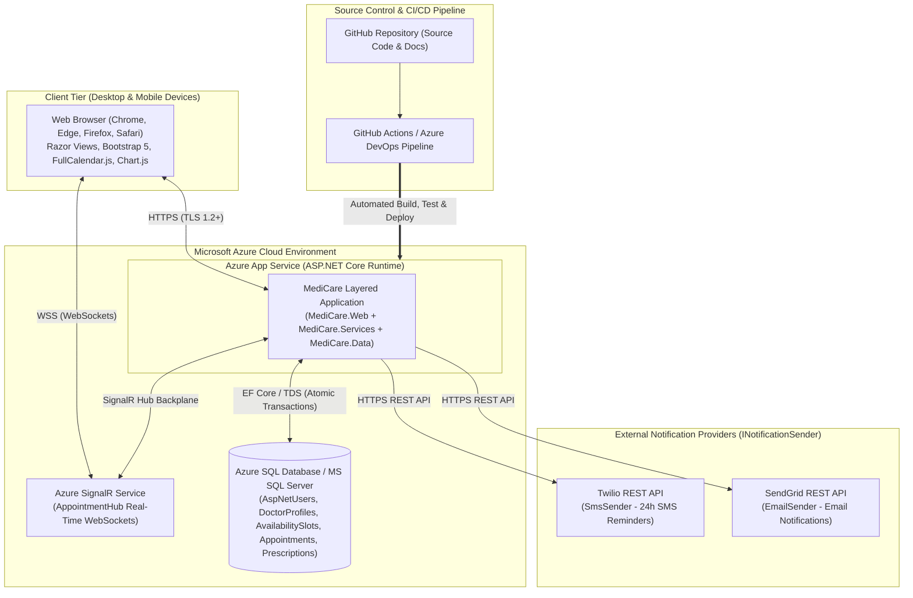
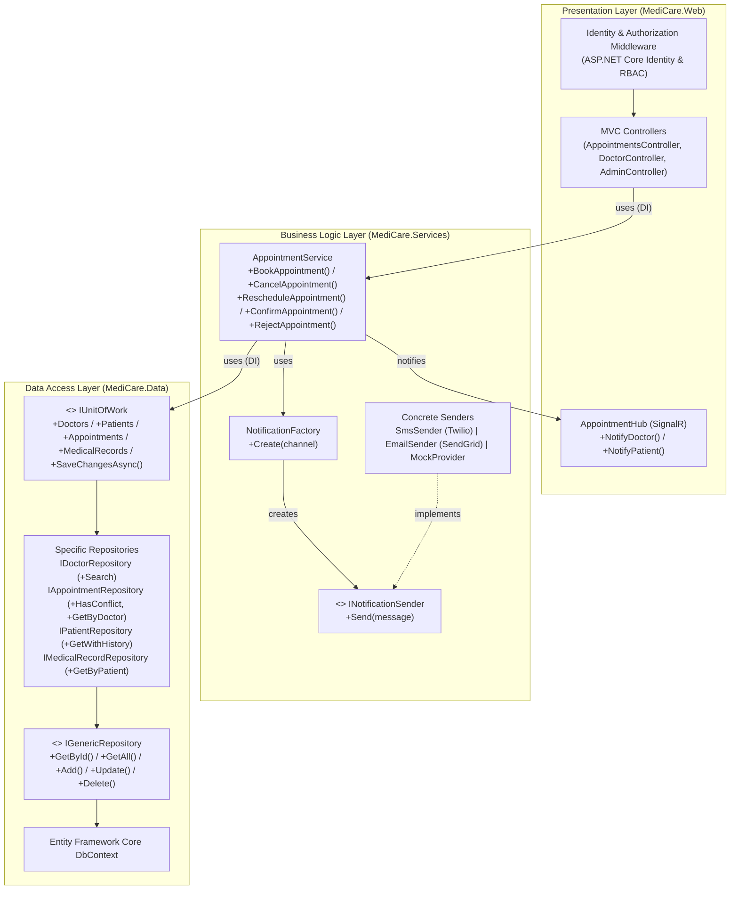

# 4.5 System Deployment & Integration

**Project Name:** MediCare - Clinic Management & Appointment System  
**DEPI Track:** Full Stack .NET Web Developer  
**Submission Deadline:** 6 November 2026  

[$\leftarrow$ Back to Main README](../README.md)

---

## 5.1 Technology Stack

The MediCare platform integrates frontend, backend, database, and cloud technologies structured around a **Layered MVC Monolith / N-Tier Architecture**:

| Layer / Category | Selected Technologies | Architectural Role & Implementation Purpose |
| :--- | :--- | :--- |
| **Frontend Technologies** | `Razor Views`, `Bootstrap 5`, `JavaScript`, `FullCalendar.js`, `Chart.js` | Renders responsive, mobile-first interfaces adhering to the brand palette (`#56060D` burgundy, `#A81420` crimson, `#FFF9F1` ivory) and `WCAG 2.2 AA` accessibility guidelines; displays interactive booking calendars and administrative analytics charts. |
| **Backend Technologies** | `C#`, `ASP.NET Core MVC`, `ASP.NET Core Identity`, `SignalR` | Implements thin MVC controllers (`MediCare.Web`), role-based authorization policies (`Patient`, `Doctor`, `Admin`), real-time WebSocket hubs (`AppointmentHub`), and decoupled business services (`MediCare.Services`) using **Dependency Injection** and the **Factory Pattern** (`NotificationFactory`). |
| **Database Technologies** | `Microsoft SQL Server` / `Azure SQL Database`, `Entity Framework Core (Code-First)` | Manages normalized (`3NF`) relational tables (`AspNetUsers`, `DoctorProfiles`, `AvailabilitySlots`, `Appointments`, `Prescriptions`) and extended clinical entities via `IUnitOfWork`, `IGenericRepository<T>`, and specific repositories (`IDoctorRepository`, `IPatientRepository`, `IAppointmentRepository`, `IMedicalRecordRepository`). |
| **Cloud & External Integrations** | `Microsoft Azure App Service`, `Azure SignalR Service`, `Twilio (SMS)`, `SendGrid (Email)`, `GitHub Actions / Azure DevOps` | Hosts the web application and real-time hubs in the cloud, dispatches SMS/Email confirmations and 24-hour reminders via `INotificationSender` (with In-App/Mock fallback), and automates CI/CD pipelines. |

---

## 5.2 Deployment Diagram

The Deployment Diagram illustrates how MediCare software components are distributed across client devices, Microsoft Azure cloud infrastructure, and external notification providers:

---

## 5.3 Component Diagram

The Component Diagram depicts the high-level software components across the three N-Tier layers (`MediCare.Web`, `MediCare.Services`, `MediCare.Data`) and their interface dependencies:

