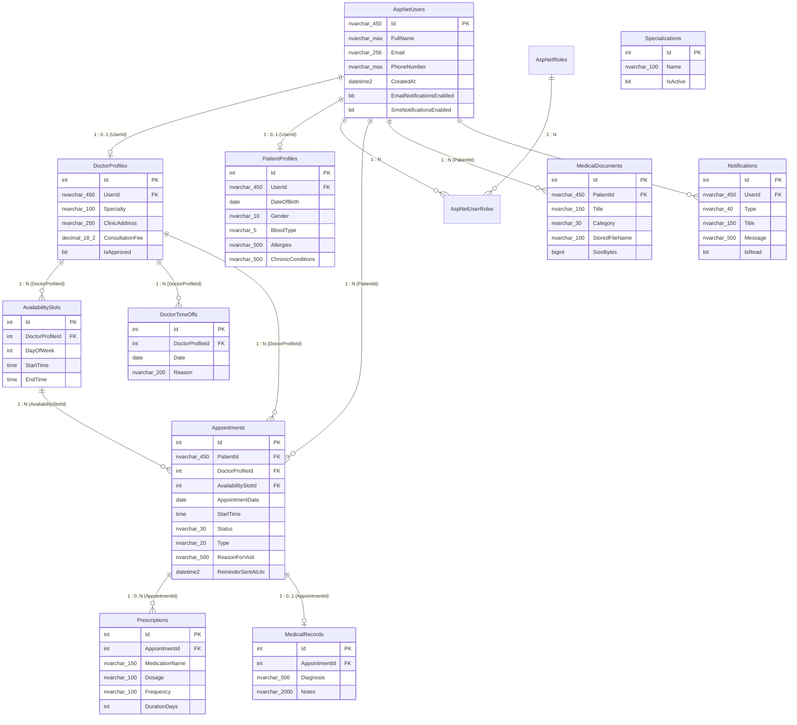

# 4.2 Database Design & Data Modeling

**Project Name:** MediCare - Clinic Management & Appointment System  
**DEPI Track:** Full Stack .NET Web Developer  
**Submission Deadline:** 6 November 2026  

[<- Back to Main README](../README.md)

> **Updated on 27 Nov 2026 to match the implemented database** (EF Core Code-First, migrations `InitialCreate` →
> `AddMedicalRecords` → `AddNotificationsAndReminders` → `AddProfilesDocumentsSpecializationsTimeOff` → `AddAppointmentType`).
> Changes from the original design: primary keys are named `Id`, foreign keys use the navigation name
> (`DoctorProfileId`, `AvailabilitySlotId`), roles live in the Identity tables instead of a `UserRole` column, the
> double-booking index only counts active appointments, and six tables were added for features built during implementation
> (medical records, notifications, patient profiles, documents, specializations and days off).

---

## 2.1 Entity-Relationship Diagram (ERD)

### Relationship Matrix
| Primary Entity | Related Entity | Cardinality | Relationship Description |
| :--- | :--- | :--- | :--- |
| `AspNetUsers` | `DoctorProfiles` | $1 : 0..1$ | A doctor account has one doctor profile (created at sign-up, completed by the doctor, approved by the admin). |
| `AspNetUsers` | `PatientProfiles` | $1 : 0..1$ | A patient account may have one medical profile (created the first time the patient saves it). |
| `AspNetUsers` ↔ `AspNetRoles` | `AspNetUserRoles` | $N : M$ | ASP.NET Core Identity roles: `Patient`, `Doctor`, `Admin`. |
| `DoctorProfiles` | `AvailabilitySlots` | $1 : N$ | A doctor defines several recurring weekly availability slots. |
| `DoctorProfiles` | `DoctorTimeOffs` | $1 : N$ | A doctor can mark several days off (one per date). |
| `DoctorProfiles` | `Appointments` | $1 : N$ | A doctor has many appointments; each appointment references one doctor. |
| `AspNetUsers (Patient)` | `Appointments` | $1 : N$ | A patient books many appointments. |
| `AvailabilitySlots` | `Appointments` | $1 : N$ | A recurring slot is referenced by many dated appointments. |
| `Appointments` | `Prescriptions` | $1 : 0..N$ | An appointment may have several medication rows. |
| `Appointments` | `MedicalRecords` | $1 : 0..1$ | A completed appointment has at most one medical record (diagnosis + notes). |
| `AspNetUsers (Patient)` | `MedicalDocuments` | $1 : N$ | A patient's files (test results, X-rays, reports), uploaded by the patient or their doctors. |
| `AspNetUsers` | `Notifications` | $1 : N$ | In-app notifications for a patient or a doctor. |
| `Specializations` | `DoctorProfiles` | by name | The admin-managed list doctors choose from; renaming a specialization updates its doctors. |

---

## 2.2 Logical & Physical Schema

### Normalization & Integrity Rules
* **First Normal Form (1NF):** Each column stores a single atomic value. Medication details are stored in individual `Prescriptions` rows rather than a delimited list.
* **Second Normal Form (2NF):** Every non-key attribute depends on the whole primary key (all tables use single-column primary keys).
* **Third Normal Form (3NF):** Non-key attributes are stored only with the entity they describe (doctor data in `DoctorProfiles`, medical profile in `PatientProfiles`, never copied into appointments).
* **Doctor Double-Booking Prevention:** a **filtered** unique index `UNIQUE (DoctorProfileId, AppointmentDate, StartTime) WHERE Status IN ('Pending','Confirmed')`. Cancelled or rejected appointments don't block the time, so it can be booked again.
* **Check constraints:** `AvailabilitySlots.EndTime > StartTime`, `Prescriptions.DurationDays > 0`.
* **Delete behavior:** appointments restrict deleting a doctor, patient or slot; profiles, documents and notifications are deleted with their user (cascade).

### Physical Database Table Specifications

#### Table 1: `AspNetUsers` (ASP.NET Core Identity user, extended)
| Column Name | Data Type | Keys / Indexes | Null? | Description |
| :--- | :--- | :--- | :--- | :--- |
| `Id` | `nvarchar(450)` | `PK` | No | Unique user identifier (Identity key). |
| `FullName` | `nvarchar(max)` | — | No | Display name. |
| `Email` / `UserName` | `nvarchar(256)` | `IX` (normalized) | Yes | Login email (unique, enforced by Identity). |
| `PhoneNumber` | `nvarchar(max)` | — | Yes | Mobile number used for SMS reminders. |
| `CreatedAt` | `datetime2` | — | No | Registration date (used for "new patients" analytics). |
| `EmailNotificationsEnabled` | `bit` | default `1` | No | Patient preference for email notifications. |
| `SmsNotificationsEnabled` | `bit` | default `1` | No | Patient preference for SMS reminders. |
| *Identity columns* | — | — | — | `PasswordHash`, `SecurityStamp`, `LockoutEnd`, `AccessFailedCount`, … (managed by Identity). Roles are in `AspNetRoles` / `AspNetUserRoles`. |

#### Table 2: `DoctorProfiles`
| Column Name | Data Type | Keys / Indexes | Null? | Description |
| :--- | :--- | :--- | :--- | :--- |
| `Id` | `int` | `PK, Identity` | No | Primary key. |
| `UserId` | `nvarchar(450)` | `FK, UQ` | No | References `AspNetUsers(Id)`. |
| `Specialty` | `nvarchar(100)` | `IX` | No | Chosen from `Specializations`. |
| `ClinicAddress` | `nvarchar(250)` | — | No | Clinic location. |
| `ConsultationFee` | `decimal(18,2)` | — | No | Fee per visit (EGP). |
| `IsApproved` | `bit` | — | No | Only approved doctors are searchable and bookable. |

#### Table 3: `AvailabilitySlots`
| Column Name | Data Type | Keys / Indexes | Null? | Description |
| :--- | :--- | :--- | :--- | :--- |
| `Id` | `int` | `PK, Identity` | No | Primary key. |
| `DoctorProfileId` | `int` | `FK` | No | References `DoctorProfiles(Id)`. |
| `DayOfWeek` | `int` | — | No | Day of week ($0 = \text{Sunday}$, $6 = \text{Saturday}$). |
| `StartTime` | `time` | — | No | Start of the working range. |
| `EndTime` | `time` | `CHECK: > StartTime` | No | End of the working range. |

#### Table 4: `Appointments`
| Column Name | Data Type | Keys / Indexes | Null? | Description |
| :--- | :--- | :--- | :--- | :--- |
| `Id` | `int` | `PK, Identity` | No | Primary key. |
| `PatientId` | `nvarchar(450)` | `FK` | No | References `AspNetUsers(Id)`. |
| `DoctorProfileId` | `int` | `FK, filtered UQ` | No | References `DoctorProfiles(Id)`. |
| `AvailabilitySlotId` | `int` | `FK` | No | References `AvailabilitySlots(Id)`. |
| `AppointmentDate` | `date` | `filtered UQ` | No | Calendar date. |
| `StartTime` | `time` | `filtered UQ` | No | Start of the 30-minute appointment. |
| `Status` | `nvarchar(30)` | — | No | `Pending`, `Confirmed`, `Rejected`, `Cancelled`, `Completed`, `NoShow` (stored as text). |
| `Type` | `nvarchar(20)` | — | No | Visit type from `AppointmentFactory`: `FirstVisit` (default), `FollowUp`, `Consultation` (stored as text; decides the price). |
| `ReasonForVisit` | `nvarchar(500)` | — | Yes | Patient's reason for the visit. |
| `ReminderSentAtUtc` | `datetime2` | — | Yes | When the 24-hour reminder was sent (cleared on reschedule). |

#### Table 5: `Prescriptions`
| Column Name | Data Type | Keys / Indexes | Null? | Description |
| :--- | :--- | :--- | :--- | :--- |
| `Id` | `int` | `PK, Identity` | No | Primary key. |
| `AppointmentId` | `int` | `FK, IX` | No | References `Appointments(Id)`. |
| `MedicationName` | `nvarchar(150)` | — | No | Medication. |
| `Dosage` | `nvarchar(100)` | — | No | e.g. 500 mg. |
| `Frequency` | `nvarchar(100)` | — | No | e.g. twice daily. |
| `DurationDays` | `int` | `CHECK: > 0` | No | Treatment duration in days. |

#### Table 6: `MedicalRecords`
| Column Name | Data Type | Keys / Indexes | Null? | Description |
| :--- | :--- | :--- | :--- | :--- |
| `Id` | `int` | `PK, Identity` | No | Primary key. |
| `AppointmentId` | `int` | `FK, UQ` | No | One record per completed appointment. |
| `Diagnosis` | `nvarchar(500)` | — | No | Doctor's diagnosis. |
| `Notes` | `nvarchar(2000)` | — | Yes | Treatment notes and advice. |
| `CreatedAtUtc` / `UpdatedAtUtc` | `datetime2` | — | No / Yes | Written / last updated. |

#### Table 7: `PatientProfiles`
| Column Name | Data Type | Keys / Indexes | Null? | Description |
| :--- | :--- | :--- | :--- | :--- |
| `Id` | `int` | `PK, Identity` | No | Primary key. |
| `UserId` | `nvarchar(450)` | `FK, UQ` | No | References `AspNetUsers(Id)`. |
| `DateOfBirth` | `date` | — | Yes | Used for age and age-group analytics. |
| `Gender` | `nvarchar(10)` | — | Yes | `Male` / `Female`. |
| `BloodType` | `nvarchar(5)` | — | Yes | `A+` … `O-`. |
| `Address` | `nvarchar(250)` | — | Yes | Patient address. |
| `Allergies`, `ChronicConditions`, `CurrentMedications` | `nvarchar(500)` | — | Yes | Shown to the treating doctor (allergies first). |
| `MedicalHistoryNotes` | `nvarchar(2000)` | — | Yes | Surgeries, past illnesses, family history. |
| `EmergencyContactName` / `EmergencyContactPhone` | `nvarchar(100)` / `nvarchar(30)` | — | Yes | Emergency contact. |
| `UpdatedAtUtc` | `datetime2` | — | No | Last update. |

#### Table 8: `MedicalDocuments`
| Column Name | Data Type | Keys / Indexes | Null? | Description |
| :--- | :--- | :--- | :--- | :--- |
| `Id` | `int` | `PK, Identity` | No | Primary key. |
| `PatientId` | `nvarchar(450)` | `FK, IX` | No | Owner (patient). |
| `UploadedByUserId` | `nvarchar(450)` | — | No | Patient or one of their doctors. |
| `AppointmentId` | `int` | — | Yes | Optional related visit. |
| `Title` / `Category` | `nvarchar(150)` / `nvarchar(30)` | — | No | Title; `Test result`, `X-ray`, `Report`, `Other`. |
| `OriginalFileName` | `nvarchar(255)` | — | No | Name shown when downloading. |
| `StoredFileName` | `nvarchar(100)` | — | No | Random name on disk (outside `wwwroot`). |
| `ContentType` / `SizeBytes` | `nvarchar(100)` / `bigint` | — | No | Verified type (PDF, JPEG, PNG) and size (≤ 10 MB). |
| `UploadedAtUtc` | `datetime2` | — | No | Upload time. |

#### Table 9: `Notifications`
| Column Name | Data Type | Keys / Indexes | Null? | Description |
| :--- | :--- | :--- | :--- | :--- |
| `Id` | `int` | `PK, Identity` | No | Primary key. |
| `UserId` | `nvarchar(450)` | `FK, IX (UserId, IsRead)` | No | Recipient. |
| `Type` | `nvarchar(40)` | — | No | `AppointmentBooked`, `…Confirmed`, `…Reminder`, … (created by `NotificationFactory`). |
| `Title` / `Message` | `nvarchar(150)` / `nvarchar(500)` | — | No | Text shown in the app, the toast and the email. |
| `Link` | `nvarchar(300)` | — | Yes | Local page to open. |
| `AppointmentId` | `int` | — | Yes | Related appointment. |
| `IsRead` | `bit` | — | No | Drives the unread badge. |
| `CreatedAtUtc` | `datetime2` | — | No | Time created. |

#### Table 10: `Specializations`
| Column Name | Data Type | Keys / Indexes | Null? | Description |
| :--- | :--- | :--- | :--- | :--- |
| `Id` | `int` | `PK, Identity` | No | Primary key. |
| `Name` | `nvarchar(100)` | `UQ` | No | e.g. Cardiology. |
| `Description` | `nvarchar(300)` | — | Yes | Optional description. |
| `IsActive` | `bit` | — | No | Hidden ones aren't offered to doctors or in search. |

#### Table 11: `DoctorTimeOffs`
| Column Name | Data Type | Keys / Indexes | Null? | Description |
| :--- | :--- | :--- | :--- | :--- |
| `Id` | `int` | `PK, Identity` | No | Primary key. |
| `DoctorProfileId` | `int` | `FK, UQ (DoctorProfileId, Date)` | No | References `DoctorProfiles(Id)`. |
| `Date` | `date` | — | No | Day off (no times offered). |
| `Reason` | `nvarchar(200)` | — | Yes | e.g. Conference. |
