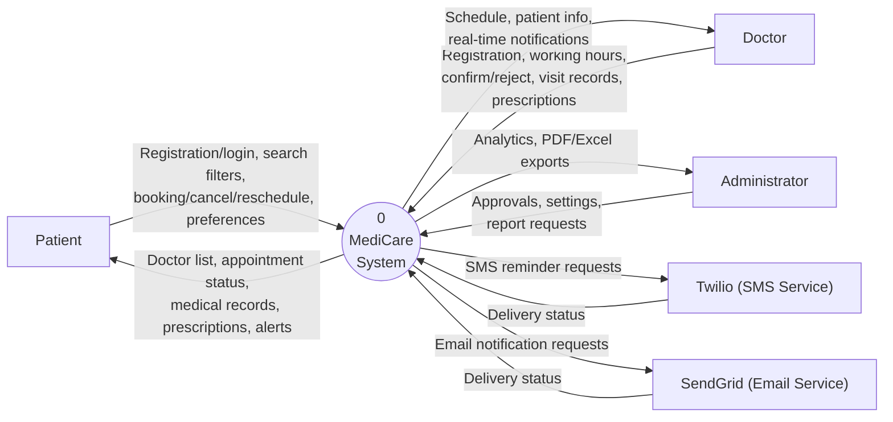
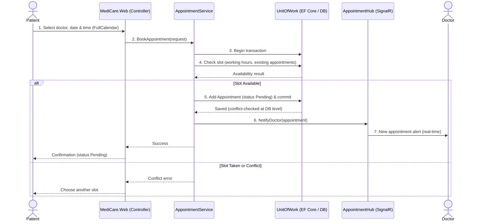
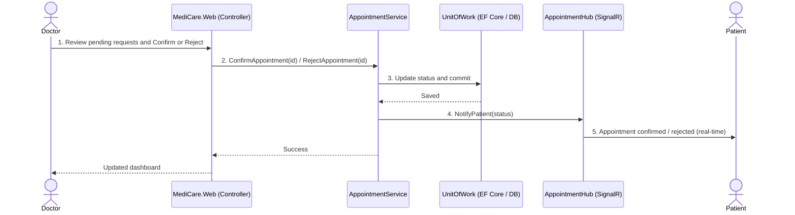
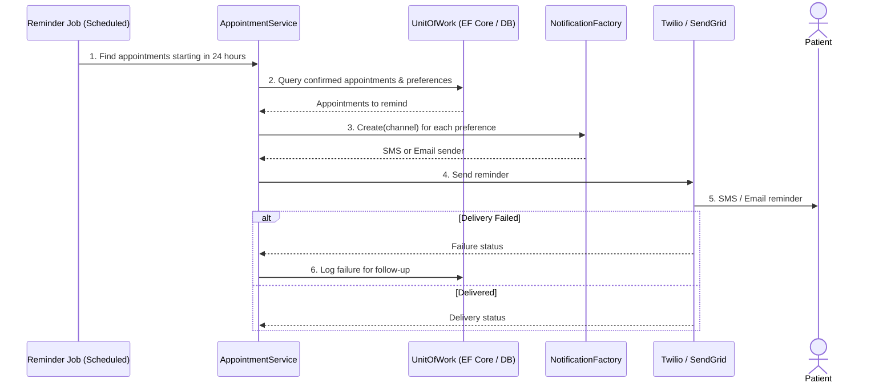
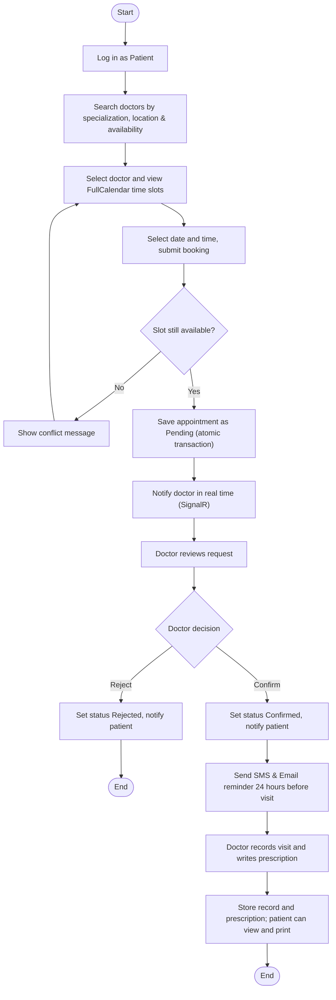
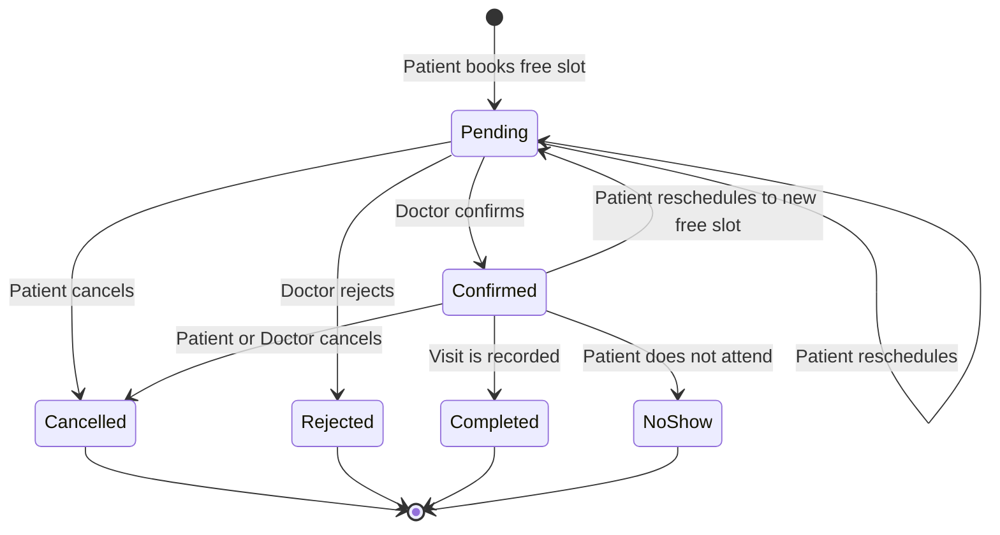
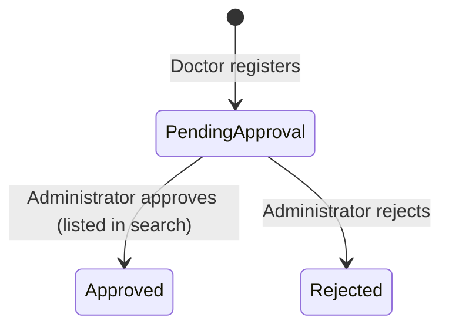
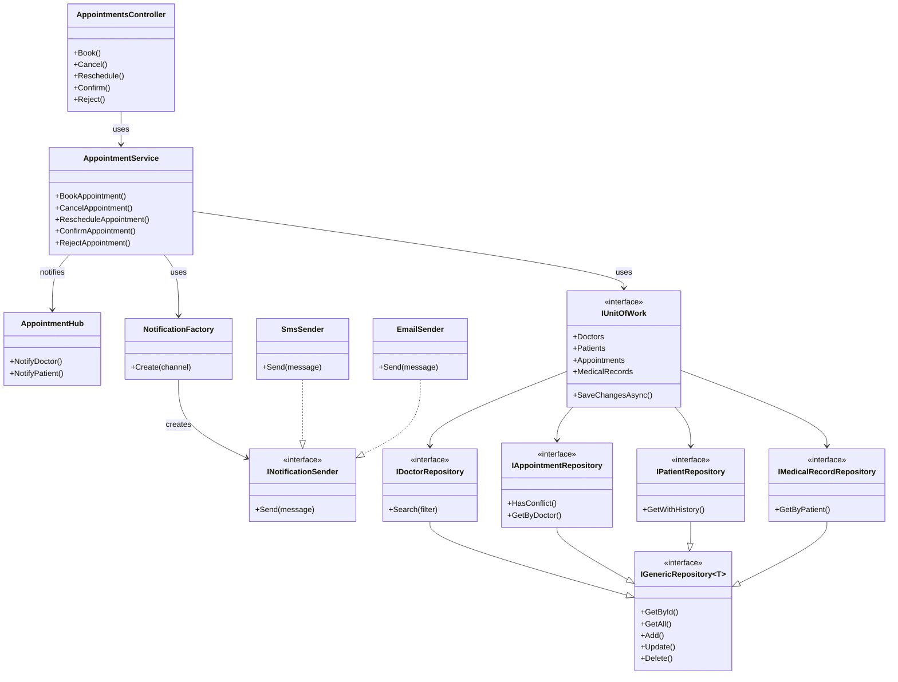

# 4.3 Data Flow & System Behavior

**Project Name:** MediCare - Clinic Management & Appointment System  
**DEPI Track:** Full Stack .NET Web Developer  
**Submission Deadline:** 6 November 2026  

[<- Back to Main README](../README.md)

---

## 1. Data Flow Diagrams (DFD)

### 1.1 Context Diagram (Level 0)

### 1.2 Level 1 DFD Process Summary
| ID | Process | Description | Data Stores |
| :--- | :--- | :--- | :--- |
| **1.0** | Authentication & Users | Registers and authenticates patients, doctors, and administrators with ASP.NET Identity and applies role-based access. | `D1 Users` |
| **2.0** | Doctor Search | Returns doctors filtered by specialization, location, and availability. | `D2 Doctors & Specializations` |
| **3.0** | Appointment Booking | Books, cancels, and reschedules appointments, using working hours for availability and checking for conflicts. | `D3 Working Hours`, `D4 Appointments` |
| **4.0** | Doctor Schedule & Dashboard | Lets doctors manage working hours and vacation days, view schedules, and confirm or reject requests. | `D3 Working Hours`, `D4 Appointments` |
| **5.0** | Medical Records & Prescriptions | Stores visit records, uploaded documents, and digital prescriptions, and shows them to authorized users. | `D5 Medical Records & Prescriptions` |
| **6.0** | Notifications | Sends real-time alerts through SignalR and reminders by SMS (Twilio) and email (SendGrid), according to preferences. | `D4 Appointments`, `D6 Notification Preferences` |
| **7.0** | Admin & Analytics | Approves doctors, manages settings, and produces Chart.js analytics with PDF and Excel export. | `D1 Users`, `D2 Doctors`, `D4 Appointments` |

---

## 2. Sequence Diagrams

### 2.1 Book an Appointment

### 2.2 Doctor Confirms or Rejects a Request

### 2.3 Automated 24-Hour Reminder

---

## 3. Activity Diagram (Patient Visit Lifecycle)

---

## 4. State Diagrams

### 4.1 Appointment States

### 4.2 Doctor Account States

---

## 5. Class Diagrams (N-Tier Layers & Services)

