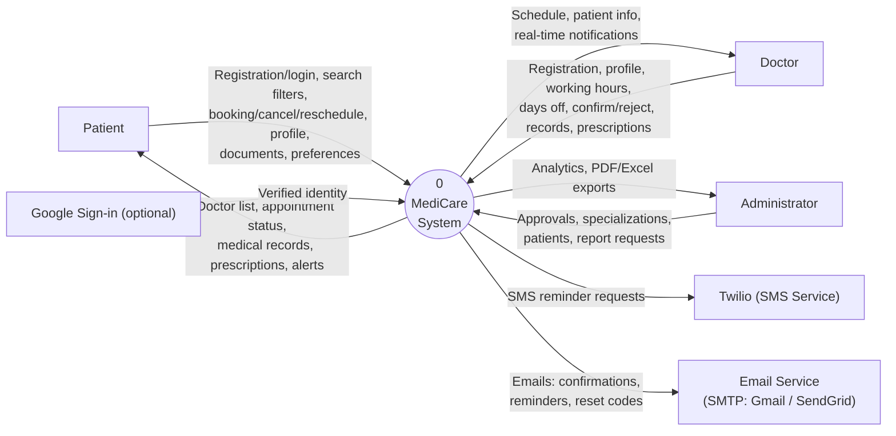
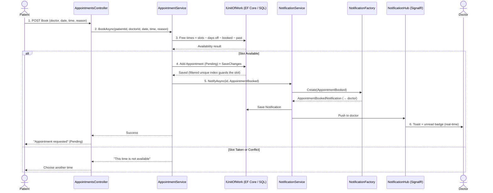
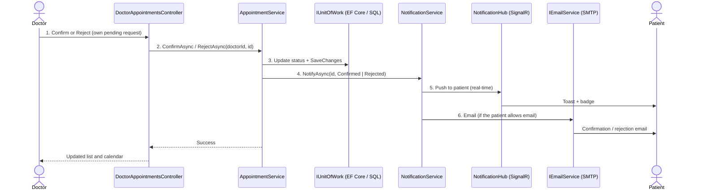
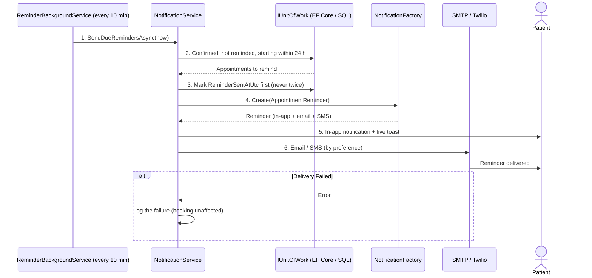
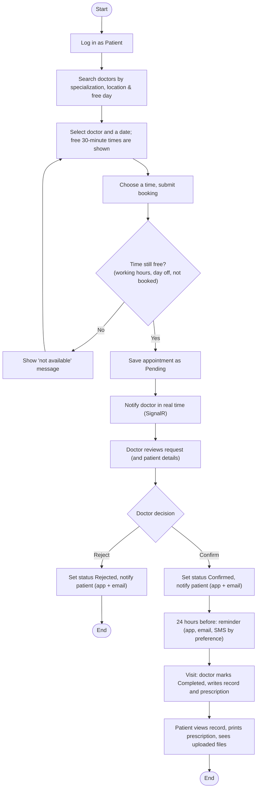
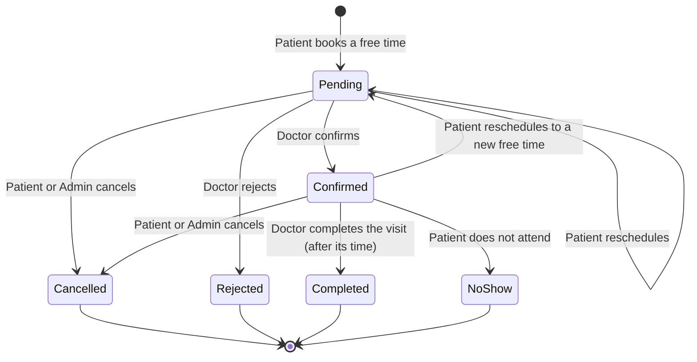
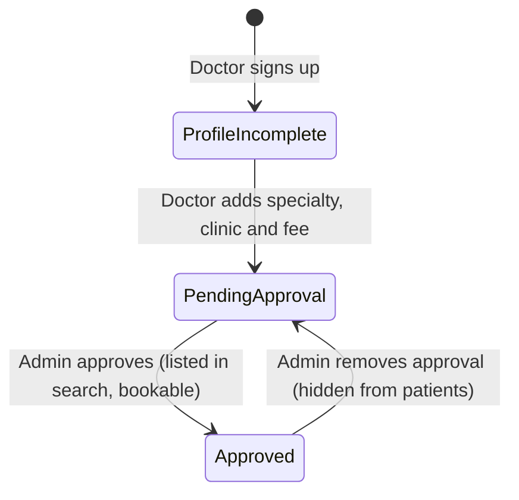
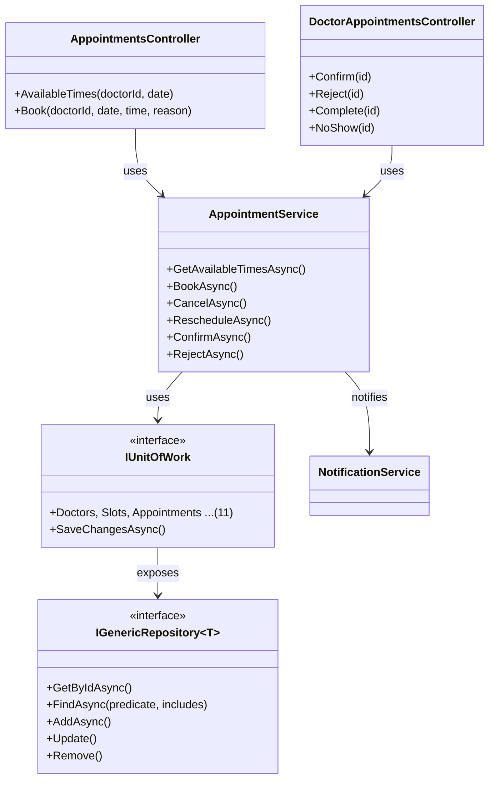
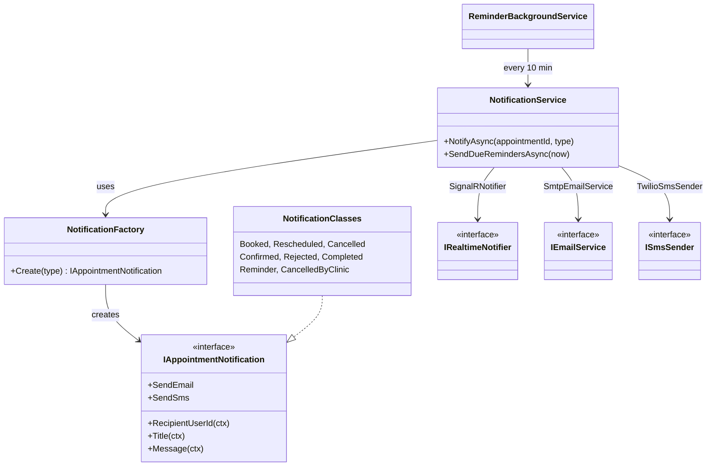

# 4.3 Data Flow & System Behavior

**Project Name:** MediCare - Clinic Management & Appointment System  
**DEPI Track:** Full Stack .NET Web Developer  
**Submission Deadline:** 6 November 2026  

[<- Back to Main README](../README.md)

> **Updated on 27 Nov 2026 to match the implemented system.** The real-time hub is `NotificationHub`; notifications are
> created by `NotificationFactory` inside `NotificationService`; reminders run in `ReminderBackgroundService`; data access
> goes through `IUnitOfWork` + `IGenericRepository<T>`; email is sent by SMTP (Gmail or SendGrid).

---

## 1. Data Flow Diagrams (DFD)

### 1.1 Context Diagram (Level 0)

### 1.2 Level 1 DFD Process Summary
| ID | Process | Description | Data Stores |
| :--- | :--- | :--- | :--- |
| **1.0** | Authentication & Users | Registers and authenticates patients, doctors and administrators with ASP.NET Identity (optional Google sign-in), applies role-based access, and resets passwords with an emailed code. | `D1 Users & Roles` |
| **2.0** | Doctor Search | Returns approved doctors filtered by specialization, name, location and a free day. | `D2 Doctors & Specializations`, `D3 Availability & Days Off`, `D4 Appointments` |
| **3.0** | Appointment Booking | Books, cancels and reschedules appointments, using working hours and days off for availability and checking for conflicts. | `D3 Availability & Days Off`, `D4 Appointments` |
| **4.0** | Doctor Schedule & Dashboard | Lets doctors manage working hours and days off, view schedules, confirm or reject requests, and open patient details. | `D3 Availability & Days Off`, `D4 Appointments`, `D5 Patient Profiles & Documents` |
| **5.0** | Medical Records & Prescriptions | Stores visit records, uploaded documents and digital prescriptions, and shows them to authorized users. | `D5 Patient Profiles & Documents`, `D6 Medical Records & Prescriptions` |
| **6.0** | Notifications | Saves in-app notifications, pushes them live through SignalR, and sends email / SMS (Twilio) according to the patient's preferences; sends 24-hour reminders. | `D4 Appointments`, `D7 Notifications`, `D1 Users (preferences)` |
| **7.0** | Admin & Analytics | Approves doctors, manages patients and specializations, cancels appointments, and produces Chart.js analytics with PDF and Excel export. | `D1`, `D2`, `D4`, `D5` |

---

## 2. Sequence Diagrams

### 2.1 Book an Appointment

### 2.2 Doctor Confirms or Rejects a Request

### 2.3 Automated 24-Hour Reminder

---

## 3. Activity Diagram (Patient Visit Lifecycle)

---

## 4. State Diagrams

### 4.1 Appointment States

### 4.2 Doctor Account States

---

## 5. Class Diagrams (N-Tier Layers & Services)

### 5.1 Booking and data access

### 5.2 Notifications (Factory Pattern)

*Each notification class decides its recipient, text, link and channels; `NotificationFactory.Create(type)` returns the right one.*
