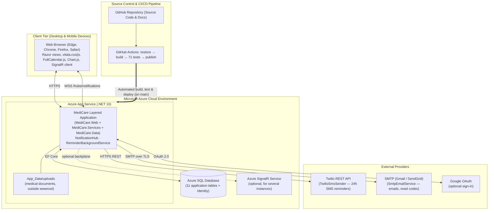
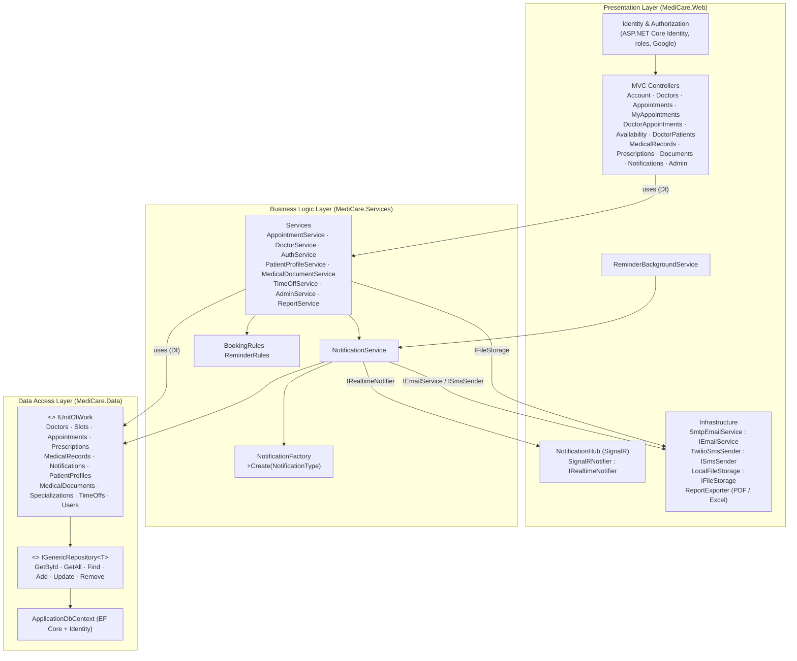

# 4.5 System Deployment & Integration

**Project Name:** MediCare - Clinic Management & Appointment System  
**DEPI Track:** Full Stack .NET Web Developer  
**Submission Deadline:** 6 November 2026  

[<- Back to Main README](../README.md)

> **Updated on 27 Nov 2026 to match the implemented system.** SignalR runs inside the App Service (Azure SignalR Service is
> optional for scale-out), email goes through SMTP (Gmail or SendGrid), the repositories are one generic repository behind the
> Unit of Work, and CI/CD is a GitHub Actions workflow (`.github/workflows/ci.yml`).

---

## 5.1 Technology Stack

The MediCare platform integrates frontend, backend, database, and cloud technologies structured around a **Layered MVC Monolith / N-Tier Architecture**:

| Layer / Category | Selected Technologies | Architectural Role & Implementation Purpose |
| :--- | :--- | :--- |
| **Frontend Technologies** | `Razor Views`, custom CSS (`vitala.css`), `JavaScript`, `FullCalendar.js 6`, `Chart.js 4`, SignalR JS client | Responsive interfaces from the team's Figma design (Vitala navy `#14248A`, sky `#67C6F5`) with dark/light mode and `WCAG 2.2 AA` guidelines; interactive doctor calendar, live notification toasts and admin charts. CDN scripts are pinned with Subresource Integrity. |
| **Backend Technologies** | `C#`, `ASP.NET Core MVC (.NET 10)`, `ASP.NET Core Identity`, `SignalR` | Thin MVC controllers (`MediCare.Web`) with role-based authorization (`Patient`, `Doctor`, `Admin`), the real-time `NotificationHub`, a hosted `ReminderBackgroundService`, and business services (`MediCare.Services`) using **Dependency Injection** and the **Factory Pattern** (`NotificationFactory`). |
| **Database Technologies** | `Microsoft SQL Server` / `Azure SQL Database`, `Entity Framework Core 10 (Code-First)` | Normalized (`3NF`) tables — `AspNetUsers`, `DoctorProfiles`, `PatientProfiles`, `AvailabilitySlots`, `DoctorTimeOffs`, `Appointments`, `Prescriptions`, `MedicalRecords`, `MedicalDocuments`, `Notifications`, `Specializations` — accessed through `IUnitOfWork` and `IGenericRepository<T>`. |
| **Cloud & External Integrations** | `Azure App Service`, `Azure SQL`, `Twilio (SMS)`, SMTP email (`Gmail` / `SendGrid`), `Google` sign-in, `GitHub Actions` | Hosts the application and its SignalR hub, sends emails (confirmations, reminders, reset codes) and SMS reminders through `IEmailService` / `ISmsSender`, and automates build, test and deployment. |
| **Reports & Testing** | `QuestPDF`, `ClosedXML`, `xUnit`, `EF Core SQLite` (tests) | PDF and Excel export of the admin analytics; 71 automated unit, integration and UI tests. |

---

## 5.2 Deployment Diagram

The Deployment Diagram illustrates how MediCare software components are distributed across client devices, Microsoft Azure cloud infrastructure, and external providers:

---

## 5.3 Component Diagram

The Component Diagram depicts the high-level software components across the three N-Tier layers (`MediCare.Web`, `MediCare.Services`, `MediCare.Data`) and their interface dependencies:

