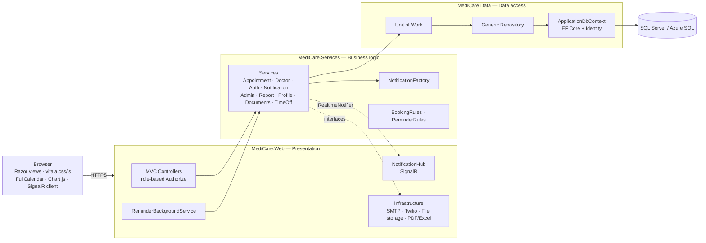
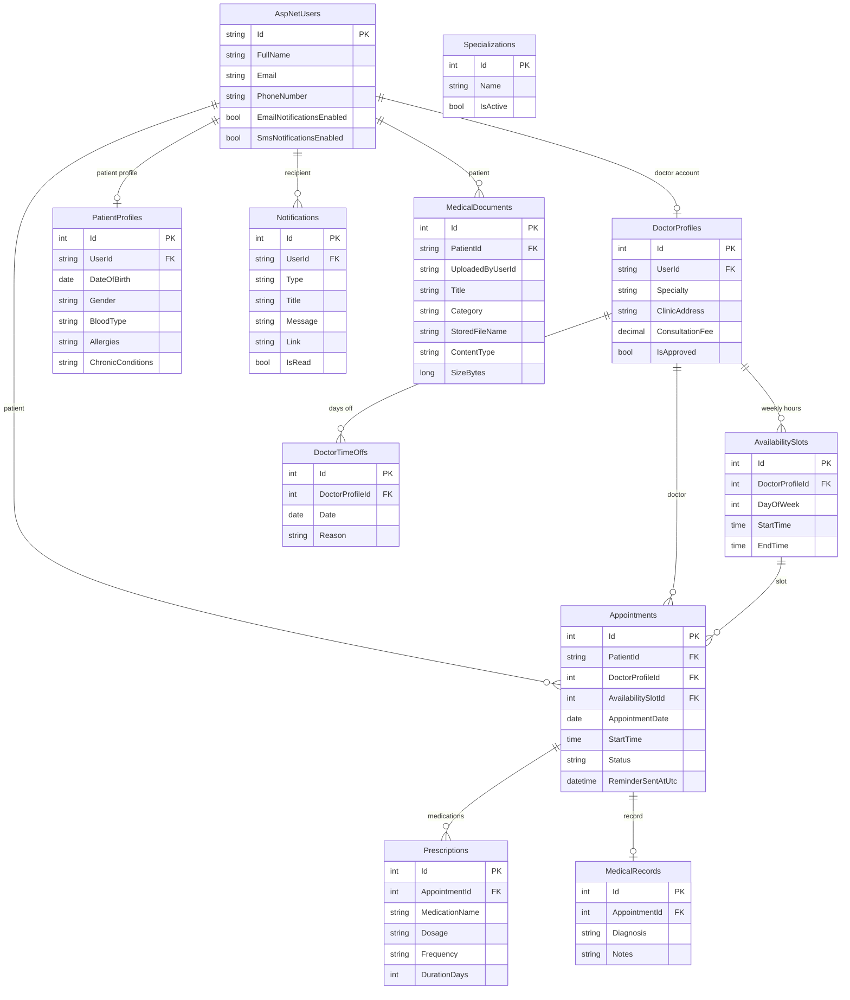
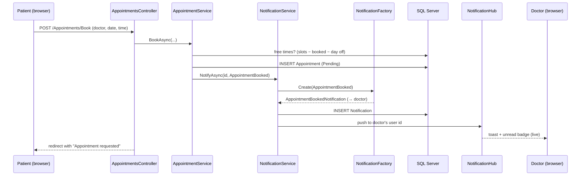
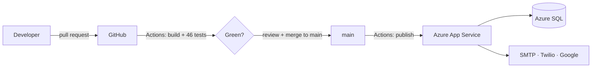

# 7.2 Technical Documentation

**Project:** MediCare – Clinic Management & Appointment System (DEPI · Full Stack .NET)  
**Stack:** ASP.NET Core MVC (.NET 10), EF Core 10, SQL Server / Azure SQL, ASP.NET Core Identity, SignalR, xUnit, GitHub Actions

[<- Back to Main README](../README.md)

---

## 1. Architecture

### 1.1 N-Tier layout

| Layer | Project | Responsibility |
| :--- | :--- | :--- |
| Presentation | `MediCare.Web` | Controllers, Razor views, SignalR hub, background job, infrastructure adapters (email, SMS, file storage, report export), DI composition (`Program.cs`) |
| Business logic | `MediCare.Services` | Use cases and rules: booking and conflicts, approval, notifications, analytics, validation. Depends only on interfaces. |
| Data access | `MediCare.Data` | Entities, `ApplicationDbContext`, migrations, `GenericRepository<T>`, `UnitOfWork`, seeders |
| Tests | `MediCare.Tests` | xUnit unit + integration tests (in-memory SQLite) |

### 1.2 Design patterns
| Pattern | Where | Why |
| :--- | :--- | :--- |
| **N-Tier** | Web → Services → Data | Separation of concerns; each layer depends only on the one below |
| **Repository** | `IGenericRepository<T>` / `GenericRepository<T>` | One abstraction for queries and persistence |
| **Unit of Work** | `IUnitOfWork` (`Doctors`, `Appointments`, `Notifications`, … + `SaveChangesAsync`) | Related changes saved in one transaction |
| **Factory** | `NotificationFactory.Create(NotificationType)` → one class per event | Callers never switch on the event; adding an event = one class + one line |
| **Dependency Injection** | `Program.cs` registers every service; controllers/services receive interfaces | Loose coupling, testability (tests swap email/SMS/real-time with fakes) |
| **Adapter (ports)** | `IEmailService`, `ISmsSender`, `IRealtimeNotifier`, `IFileStorage` implemented in Web | Business logic doesn't depend on SMTP, Twilio, SignalR or the disk |
| **Background worker** | `ReminderBackgroundService` (hosted service) | Periodic 24-hour reminders |

---

## 2. Database

Code-first with EF Core migrations (`MediCare.Data/Migrations`).

### 2.1 Entity–relationship diagram

### 2.2 Key constraints and indexes
| Table | Rule |
| :--- | :--- |
| `Appointments` | **Unique (DoctorProfileId, AppointmentDate, StartTime) where Status IN (Pending, Confirmed)**: a second guard against double booking. Status stored as text. |
| `AvailabilitySlots` | Check `EndTime > StartTime` |
| `Prescriptions` | Check `DurationDays > 0` |
| `DoctorProfiles` | Unique `UserId`; index on `Specialty` |
| `PatientProfiles` | Unique `UserId` (one profile per patient) |
| `MedicalRecords` | Unique `AppointmentId` (one record per visit) |
| `DoctorTimeOffs` | Unique (DoctorProfileId, Date) |
| `Specializations` | Unique `Name` |
| `Notifications` | Index (UserId, IsRead) for the unread badge |

### 2.3 Migrations
`InitialCreate` → `AddMedicalRecords` → `AddNotificationsAndReminders` → `AddProfilesDocumentsSpecializationsTimeOff`.
Apply with `dotnet ef database update --project MediCare.Data --startup-project MediCare.Web`.

---

## 3. Application endpoints

MVC actions (HTML pages and form posts). Every POST requires an anti-forgery token.
JSON endpoints are marked **JSON**.

| Controller | Access | Actions |
| :--- | :--- | :--- |
| `Home` | Everyone | `GET Index` (landing) |
| `Account` | Everyone | `GET SelectRole`, `GET/POST Signup`, `GET/POST Login`, `POST Logout`, `GET AccessDenied`, `GET/POST ForgotPassword`, `GET/POST VerifyOtp`, `POST ResendOtp`, `GET/POST ResetPassword`, `POST ExternalLogin`, `GET ExternalLoginCallback` |
| `Doctors` | Everyone | `GET Index?specialty&name&location&date` |
| `Appointments` | Patient | `GET Book?doctorId&date`, `POST Book`, **JSON** `GET AvailableTimes?doctorId&date` |
| `MyAppointments` | Patient | `GET Index`, `POST Cancel`, `GET/POST Reschedule` |
| `MyPrescriptions`, `MyMedicalRecords` | Patient | `GET Index` |
| `PatientProfile` | Patient | `GET Index`, `POST Save` |
| `Documents` | Patient (list/upload), Patient + Doctor (view) | `GET Index`, `POST Upload` (multipart), `GET Download/{id}?download`, `POST Delete` |
| `Patient` | Patient | `GET Home`, `GET Cart` |
| `DoctorAppointments` | Doctor | `GET Index`, **JSON** `GET Events` (FullCalendar), `POST Confirm`, `POST Reject`, `POST Complete`, `POST NoShow` |
| `Availability` | Doctor | `GET Index`, `POST Add`, `POST Remove`, `POST AddTimeOff`, `POST RemoveTimeOff` |
| `DoctorProfile` | Doctor | `GET Index`, `POST Save` |
| `DoctorPatients` | Doctor (own patients only) | `GET Details?patientId`, `POST Upload` |
| `MedicalRecords` | Doctor | `GET Edit?appointmentId`, `POST Save` |
| `Prescriptions` | Doctor | `GET Index?appointmentId`, `POST Add` |
| `Notifications` | Patient, Doctor | `GET Index`, `POST Open`, `POST MarkAllRead`, **JSON** `GET UnreadCount` |
| `Admin` | Admin | `GET Dashboard?from&to`, `GET ExportPdf`, `GET ExportExcel`, `GET Doctors`, `POST Approve`, `POST Unapprove`, `GET Patients?q`, `POST SetPatientLocked`, `GET Appointments?status&from&to&q`, `POST CancelAppointment`, `GET Specializations`, `POST AddSpecialization`, `POST UpdateSpecialization` |
| **SignalR** | Signed in | Hub `/hubs/notifications`; server → client event `notification { id, title, message, link, unreadCount }` |

---

## 4. Key flows

### 4.1 Booking and notifications

### 4.2 24-hour reminder
`ReminderBackgroundService` runs every `Reminders:IntervalMinutes` (default 10) → `SendDueRemindersAsync(now)`:
it selects **Confirmed** appointments with `ReminderSentAtUtc = null` whose start is within `(now, now + 24h]`
(`ReminderRules.IsDue`), marks them sent **first** (so a crash can't send twice), then sends in-app + live + email + SMS,
following the patient's preferences.

### 4.3 Password reset
`ForgotPassword` creates a random 4-digit code, stored **hashed** (SHA-256 with the user id) in `AspNetUserTokens` with
creation/expiry time and attempt count. The same response is returned for unknown emails. `VerifyOtp` checks the code in
constant time and returns an Identity reset token. The email and token move between steps in encrypted TempData.

---

## 5. Security
| Area | Measure |
| :--- | :--- |
| Authentication | ASP.NET Core Identity (hashed passwords, lockout after failed attempts), optional Google OAuth |
| Authorization | `[Authorize(Roles = …)]` on every controller; per-record ownership checks in services (a doctor only sees/changes their own appointments and patients; a patient only their own data) |
| CSRF | Anti-forgery token on every POST form (`[ValidateAntiForgeryToken]`) |
| XSS | Razor HTML-encoding; live notifications inserted with `textContent`; JSON data islands escape `<` |
| SQL injection | EF Core parameterized queries only |
| Open redirect | `Url.IsLocalUrl` / `LocalRedirect` for every return URL |
| File uploads | PDF/JPG/PNG only, ≤ 10 MB, **type verified by magic bytes**, random stored names, outside `wwwroot`, served through an authorized action with `X-Content-Type-Options: nosniff` |
| Secrets | user-secrets locally, App Service settings in Azure; nothing in git |
| Third-party scripts | CDN scripts pinned with Subresource Integrity |
| Account enumeration | Same responses for unknown emails (login, password reset) |
| Admin actions | Blocking a patient sets Identity lockout and rotates the security stamp (signs them out everywhere) |

---

## 6. Configuration
| Key | Purpose | Default |
| :--- | :--- | :--- |
| `ConnectionStrings:DefaultConnection` | SQL Server / Azure SQL | LocalDB `MediCareDb` |
| `Email:Host`, `Port`, `UserName`, `Password`, `From`, `EnableSsl` | SMTP (Gmail App Password or SendGrid SMTP) | not set → Development logs emails |
| `Twilio:AccountSid`, `AuthToken`, `From` | SMS reminders | not set → Development logs SMS |
| `Authentication:Google:ClientId`, `ClientSecret` | Google sign-in | not set → button explains it's not set up |
| `Reminders:Enabled`, `Reminders:IntervalMinutes` | Reminder job | `true`, `10` |
| `Storage:UploadsPath` | Medical documents folder | `<app>/App_Data/uploads` |

---

## 7. Build, test and deployment
- **Local:** see the README (*Getting Started*).
- **Tests:** `dotnet test MediCare.slnx` (46 tests). Details in *6. Testing and Quality Assurance*.
- **CI:** GitHub Actions `.github/workflows/ci.yml`. Every pull request and push to `main` restores, builds (Release) and
  runs all tests, then uploads the results.
- **CD:** the same workflow publishes `MediCare.Web` and deploys to **Azure App Service** on pushes to `main` once the
  `AZURE_WEBAPP_NAME` variable and `AZURE_WEBAPP_PUBLISH_PROFILE` secret are set. Production configuration (Azure SQL
  connection string, SMTP, Twilio, Google) lives in App Service settings; migrations are applied once with
  `dotnet ef database update --connection "<Azure SQL>"`.

